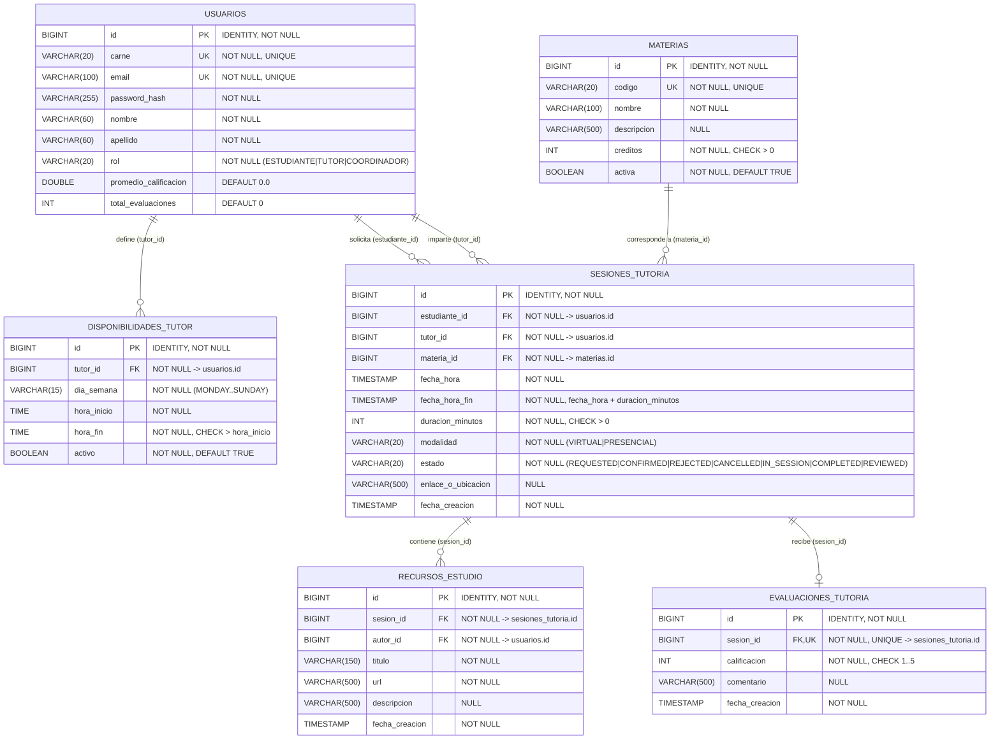

# Modelo Entidad-Relación (ERD) — EduMentor Hub

**Curso:** IF0009 Desarrollo de Software IV  
**Responsable de diseño:** Persona 2 (Módulo de Materias y Disponibilidad)  
**Motor de base de datos:** H2 (desarrollo local) / SQL Server (producción)

---

## 1. Diagrama Entidad-Relación (Mermaid)

---

## 2. Diccionario de Entidades y Restricciones

### 2.1. `usuarios` (Módulo P1 — Seguridad y usuarios)
Almacena todos los usuarios de la plataforma (estudiantes, tutores y coordinadores). Los campos de calificación agregada permiten consultar el perfil y promedio del tutor de manera eficiente (coordinado con P4).

| Columna | Atributo JPA | Tipo SQL (H2 / SQL Server) | Restricciones | Descripción |
| :--- | :--- | :--- | :--- | :--- |
| `id` | `id` | `BIGINT` | `PK`, `IDENTITY`, `NOT NULL` | Identificador único del usuario |
| `carne` | `carne` | `VARCHAR(20)` | `NOT NULL`, `UNIQUE` | Carné universitario institucional |
| `email` | `email` | `VARCHAR(100)` | `NOT NULL`, `UNIQUE` | Correo electrónico para autenticación |
| `password_hash` | `passwordHash` | `VARCHAR(255)` | `NOT NULL` | Hash BCrypt de la contraseña |
| `nombre` | `nombre` | `VARCHAR(60)` | `NOT NULL` | Nombre del usuario |
| `apellido` | `apellido` | `VARCHAR(60)` | `NOT NULL` | Apellido del usuario |
| `rol` | `rol` | `VARCHAR(20)` | `NOT NULL`, `ENUM` | `ESTUDIANTE`, `TUTOR`, `COORDINADOR` |
| `promedio_calificacion` | `promedioCalificacion` | `DOUBLE` / `FLOAT` | `NULL`, `DEFAULT 0.0` | Promedio acumulado de evaluaciones como tutor |
| `total_evaluaciones` | `totalEvaluaciones` | `INT` | `NULL`, `DEFAULT 0` | Cantidad total de evaluaciones recibidas |

---

### 2.2. `materias` (Módulo P2 — Materias y disponibilidad)
Catálogo de cursos académicos disponibles para solicitar tutorías. Su creación, edición y eliminación es exclusiva del rol `COORDINADOR`.

| Columna | Atributo JPA | Tipo SQL (H2 / SQL Server) | Restricciones | Descripción |
| :--- | :--- | :--- | :--- | :--- |
| `id` | `id` | `BIGINT` | `PK`, `IDENTITY`, `NOT NULL` | Identificador único de la materia |
| `codigo` | `codigo` | `VARCHAR(20)` | `NOT NULL`, `UNIQUE` | Sigla oficial del curso (ej. `IF0009`) |
| `nombre` | `nombre` | `VARCHAR(100)` | `NOT NULL` | Nombre completo de la materia |
| `descripcion` | `descripcion` | `VARCHAR(500)` | `NULL` | Resumen temático opcional de la materia |
| `creditos` | `creditos` | `INT` | `NOT NULL`, `CHECK (creditos > 0)` | Cantidad de créditos académicos |
| `activa` | `activa` | `BOOLEAN` / `BIT` | `NOT NULL`, `DEFAULT TRUE` | Indica si la materia está activa en el catálogo |

---

### 2.3. `disponibilidades_tutor` (Módulo P2 — Materias y disponibilidad)
Define los bloques horarios semanales recurrentes en los que un tutor ofrece atención.

| Columna | Atributo JPA | Tipo SQL (H2 / SQL Server) | Restricciones | Descripción |
| :--- | :--- | :--- | :--- | :--- |
| `id` | `id` | `BIGINT` | `PK`, `IDENTITY`, `NOT NULL` | Identificador único del bloque |
| `tutor_id` | `tutor` | `BIGINT` | `FK -> usuarios(id)`, `NOT NULL` | Referencia al usuario con rol `TUTOR` |
| `dia_semana` | `diaSemana` | `VARCHAR(15)` | `NOT NULL`, `ENUM` (`java.time.DayOfWeek`) | `MONDAY`, `TUESDAY`, `WEDNESDAY`, `THURSDAY`, `FRIDAY`, `SATURDAY`, `SUNDAY` |
| `hora_inicio` | `horaInicio` | `TIME` | `NOT NULL` | Hora de inicio del bloque (`HH:mm:ss`) |
| `hora_fin` | `horaFin` | `TIME` | `NOT NULL`, `CHECK (hora_fin > hora_inicio)` | Hora de fin del bloque (`HH:mm:ss`) |
| `activo` | `activo` | `BOOLEAN` / `BIT` | `NOT NULL`, `DEFAULT TRUE` | Permite habilitar/deshabilitar el bloque sin perder historial |

**Reglas de negocio en servicio (`DisponibilidadService`):**
- `hora_inicio` debe ser estrictamente menor que `hora_fin`.
- El usuario referenciado por `tutor_id` debe tener rol `TUTOR`.
- No pueden existir dos bloques con `activo = TRUE` del mismo tutor y mismo `dia_semana` cuyos intervalos `[hora_inicio, hora_fin)` se traslapen (`nuevoInicio < existenteFin && nuevoFin > existenteInicio`).

---

### 2.4. `sesiones_tutoria` (Módulo P3 — Sesiones de tutoría)
Registra cada reserva de tutoría solicitada por un estudiante con un tutor para una materia específica, incluyendo su ciclo de vida (máquina de estados).

| Columna | Atributo JPA | Tipo SQL (H2 / SQL Server) | Restricciones | Descripción |
| :--- | :--- | :--- | :--- | :--- |
| `id` | `id` | `BIGINT` | `PK`, `IDENTITY`, `NOT NULL` | Identificador único de la sesión |
| `estudiante_id` | `estudiante` | `BIGINT` | `FK -> usuarios(id)`, `NOT NULL` | Estudiante que solicita la sesión |
| `tutor_id` | `tutor` | `BIGINT` | `FK -> usuarios(id)`, `NOT NULL` | Tutor que imparte la sesión |
| `materia_id` | `materia` | `BIGINT` | `FK -> materias(id)`, `NOT NULL` | Materia objeto de la tutoría |
| `fecha_hora` | `fechaHora` | `TIMESTAMP` / `DATETIME2` | `NOT NULL` | Fecha y hora programada de inicio |
| `fecha_hora_fin` | `fechaHoraFin` | `TIMESTAMP` / `DATETIME2` | `NOT NULL` | Fin calculado (`fecha_hora + duracion_minutos`); permite detectar traslapes con una sola consulta |
| `duracion_minutos` | `duracionMinutos` | `INT` | `NOT NULL`, `CHECK (duracion_minutos > 0)` | Duración planificada en minutos |
| `modalidad` | `modalidad` | `VARCHAR(20)` | `NOT NULL`, `ENUM` | `VIRTUAL`, `PRESENCIAL` |
| `estado` | `estado` | `VARCHAR(20)` | `NOT NULL`, `ENUM` | `REQUESTED`, `CONFIRMED`, `REJECTED`, `CANCELLED`, `IN_SESSION`, `COMPLETED`, `REVIEWED` |
| `enlace_o_ubicacion` | `enlaceOUbicacion` | `VARCHAR(500)` | `NULL` | Enlace de videollamada o aula asignada |
| `fecha_creacion` | `fechaCreacion` | `TIMESTAMP` / `DATETIME2` | `NOT NULL` | Marca de tiempo de creación de la solicitud |

---

### 2.5. `recursos_estudio` (Módulo P4 — Recursos y evaluaciones)
Materiales de apoyo (enlaces, documentos, guías) compartidos por los participantes de una sesión de tutoría.

| Columna | Atributo JPA | Tipo SQL (H2 / SQL Server) | Restricciones | Descripción |
| :--- | :--- | :--- | :--- | :--- |
| `id` | `id` | `BIGINT` | `PK`, `IDENTITY`, `NOT NULL` | Identificador único del recurso |
| `sesion_id` | `sesion` | `BIGINT` | `FK -> sesiones_tutoria(id)`, `NOT NULL` | Sesión a la que pertenece el recurso |
| `autor_id` | `autor` | `BIGINT` | `FK -> usuarios(id)`, `NOT NULL` | Participante (tutor o estudiante) que agregó el recurso |
| `titulo` | `titulo` | `VARCHAR(150)` | `NOT NULL` | Nombre descriptivo del material |
| `url` | `url` | `VARCHAR(500)` | `NOT NULL` | Enlace al recurso de estudio |
| `descripcion` | `descripcion` | `VARCHAR(500)` | `NULL` | Notas o contexto opcional |
| `fecha_creacion` | `fechaCreacion` | `TIMESTAMP` / `DATETIME2` | `NOT NULL` | Fecha de publicación del recurso |

---

### 2.6. `evaluaciones_tutoria` (Módulo P4 — Recursos y evaluaciones)
Calificación y retroalimentación otorgada por el estudiante al finalizar una sesión en estado `COMPLETED`.

| Columna | Atributo JPA | Tipo SQL (H2 / SQL Server) | Restricciones | Descripción |
| :--- | :--- | :--- | :--- | :--- |
| `id` | `id` | `BIGINT` | `PK`, `IDENTITY`, `NOT NULL` | Identificador único de la evaluación |
| `sesion_id` | `sesion` | `BIGINT` | `FK -> sesiones_tutoria(id)`, `NOT NULL`, `UNIQUE` | Relación 1:1 opcional (máximo una evaluación por sesión) |
| `calificacion` | `calificacion` | `INT` | `NOT NULL`, `CHECK (calificacion BETWEEN 1 AND 5)` | Puntuación en estrellas de 1 a 5 |
| `comentario` | `comentario` | `VARCHAR(500)` | `NULL` | Comentario cualitativo opcional |
| `fecha_creacion` | `fechaCreacion` | `TIMESTAMP` / `DATETIME2` | `NOT NULL` | Fecha en la que se registró la evaluación |

---

## 3. Resumen de Cardinalidades y Relaciones

| Relación | Entidad Origen | Cardinalidad | Entidad Destino | Llave Foránea | Semántica |
| :--- | :--- | :---: | :--- | :--- | :--- |
| R1 | `usuarios` (Tutor) | `1` — `0..*` | `disponibilidades_tutor` | `disponibilidades_tutor.tutor_id` | Un tutor puede tener cero o múltiples bloques de disponibilidad; cada bloque pertenece exactamente a un tutor. |
| R2 | `usuarios` (Estudiante) | `1` — `0..*` | `sesiones_tutoria` | `sesiones_tutoria.estudiante_id` | Un estudiante puede solicitar múltiples sesiones; cada sesión tiene exactamente un estudiante solicitante. |
| R3 | `usuarios` (Tutor) | `1` — `0..*` | `sesiones_tutoria` | `sesiones_tutoria.tutor_id` | Un tutor puede impartir múltiples sesiones; cada sesión tiene exactamente un tutor asignado. |
| R4 | `materias` | `1` — `0..*` | `sesiones_tutoria` | `sesiones_tutoria.materia_id` | Una materia puede estar asociada a muchas sesiones; cada sesión corresponde a una única materia. |
| R5 | `sesiones_tutoria` | `1` — `0..*` | `recursos_estudio` | `recursos_estudio.sesion_id` | Una sesión puede contener múltiples recursos de estudio; cada recurso pertenece a una sesión. |
| R6 | `usuarios` | `1` — `0..*` | `recursos_estudio` | `recursos_estudio.autor_id` | Un participante puede publicar múltiples recursos de estudio. |
| R7 | `sesiones_tutoria` | `1` — `0..1` | `evaluaciones_tutoria` | `evaluaciones_tutoria.sesion_id` (`UNIQUE`) | Una sesión solo puede ser evaluada una única vez (solo en estado `COMPLETED`, tras lo cual pasa a `REVIEWED`). |

---

## 4. Consideraciones de Rendimiento e Integridad

- **Índices recomendados:**
  - `idx_disp_tutor_dia_activo` sobre `disponibilidades_tutor (tutor_id, dia_semana, activo)` para acelerar validaciones de traslape y el método `estaDisponible(...)`.
  - `idx_sesiones_tutor_fecha` sobre `sesiones_tutoria (tutor_id, estado, fecha_hora)` y `idx_sesiones_estudiante_fecha` sobre `sesiones_tutoria (estudiante_id, estado, fecha_hora)` para la detección de cruces de horario.
- **Prevención de N+1:** Todas las asociaciones `@ManyToOne` utilizan `FetchType.LAZY` y las consultas de listado emplean `JOIN FETCH` o `@EntityGraph`.
